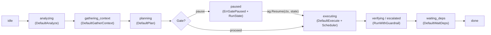

# Agent FSM Lifecycle, Gates, Snapshots & DAG Schedulers

---

## 1. Finite-State Machine Stages (`AgentStatus`)

Every `Run`, `RunDetailed`, `RunTask`, `Chat`, or `StreamChat` invocation creates an isolated `runSession` and advances through `Pipeline[S]`:



### Built-in Lifecycle Phases

1. **`StatusAnalyzing` (`DefaultAnalyze`, opt-in via `WithEnableAnalyze(true)`):**
   Runs initial task analysis using `ModelFor(StatusAnalyzing)` and stores the result in `RunState.Analysis`. Skipped automatically on resume if `Analysis` is already populated.
2. **`StatusGatheringContext` (`DefaultGatherContext`):**
   Collects textual context from registered `DataSource`s.
   - When **`WithSelectiveGather(true)`** is enabled and multiple `DataSource`s are present, the `StatusGatheringContext` model (e.g. a fast `decision` model) selects only relevant source names via structured JSON Schema before `.Content(ctx)` is loaded.
   - Calls `ValidateWindow(SystemPrefix, dynamicCtx, MaxContextTokens)` to ensure prompt boundaries fit within the target context window.
3. **`StatusPlanning` (`DefaultPlan`, opt-in via `WithEnablePlan(true)`):**
   Renders the planning template with `Task`, `Context`, and `Analysis`, invokes `PlanModel` (or `StageModels[StatusPlanning]`), strips optional markdown code fences, and populates `RunState.Plan` (`[]PlanStep`).
   *Preset specialized subagents configured with `WithSkipPlanning(true)` bypass Analyze, GatherContext, and Plan, jumping straight to `StatusExecuting`.*
4. **`StatusExecuting` (`DefaultExecute`):**
   Hands `RunState.Plan` (or a single `step-1` node) to the configured `Scheduler`. Every step runs inside `RunWithGuardrail` and records its output in `RunState.StepResults[step.ID]`.
5. **`StatusWaitingDeps` (`DefaultWaitDeps`):**
   Final join barrier awaiting any remaining active background subagents (`activeFutures`).

### Per-Stage Model Routing

Assign lightweight classifiers or fast models to routine stages and reserve heavy models for planning and escalation:

```go
ag := agentgo.New[MyState](
    agentgo.WithModel[MyState]("gemini-2.5-flash"),
    agentgo.WithStageModel[MyState](agentgo.StatusAnalyzing, "jev-latest"),
    agentgo.WithStageModel[MyState](agentgo.StatusGatheringContext, "jev-latest"),
    agentgo.WithStageModel[MyState](agentgo.StatusPlanning, "claude-sonnet-4-20250514"),
    agentgo.WithStageModel[MyState](agentgo.StatusExecuting, "jev-latest"),
    agentgo.WithStageModel[MyState](agentgo.StatusEscalated, "claude-sonnet-4-20250514"),
)
```

---

## 2. Checkpoint `Gates`, Atomic Snapshots & `Resume`

For human-in-the-loop workflows (such as approving a plan before rendering):

1. Configure gated stage names via `WithGates("plan")` (standard stage names: `"analyze"`, `"gather"`, `"plan"`, `"execute"`, `"wait_deps"`).
2. Optionally attach `Hooks.OnGate(ctx, state, gate) (proceed bool, err error)`. When omitted or returning `false`, execution pauses cleanly:
   - `RunDetailed(ctx)` returns `RunResult{Paused: true, Gate: "plan", State: snap}` along with `ErrGatePaused` (`errors.Is(err, agentgo.ErrGatePaused)`).
3. Persist both `RunState` and `MemoryBank` atomically to disk:
   ```go
   _ = agentgo.SaveSnapshot("runs/run-42.json", res.State, ag.EnsureBank())
   ```
4. Once approved (or after editing `snap.RunState.Plan`), reload and resume from the exact next stage:
   ```go
   loaded, _ := agentgo.LoadSnapshot("runs/run-42.json", ag.EnsureBank())
   finalRes, err := ag.Resume(ctx, loaded.RunState)
   ```
   Completed stages in `CompletedStages` and precomputed `StepResults` are never re-executed.

---

## 3. DAG Schedulers, Subagent Fan-Out & Point-to-Point `SubFuture` Joins

### `SequentialScheduler` & `DAGParallelScheduler`

- **`SequentialScheduler`** (default) executes ready DAG steps one at a time in topological order, injecting dependency outputs into downstream prompts.
- **`DAGParallelScheduler{MaxConcurrency: N}`** executes independent ready steps concurrently up to `MaxConcurrency` with panic recovery and clean goroutine synchronization on context cancellation.
- Cyclic or unresolvable dependencies fail fast with a descriptive error.

### Non-Blocking Fan-Out & Targeted `DependsOn` Synchronization

A coordinator agent can spawn 50+ named background subagents without blocking via `ag.SpawnAsync(ctx, "tts_scene_3", child)` or inside a tool via `ctx.SpawnNamed("tts_scene_3", child)`:

- Returns a `*Future` (`Await(ctx)`, `Done()`) immediately while the coordinator continues executing independent steps.
- When step `assemble_scene_3` declares `DependsOn: []string{"tts_scene_3"}`, the scheduler **awaits only `"tts_scene_3"`** without blocking on the other 49 background subagents.

### Dynamic Mid-Run Plan Expansion (`AppendPlanSteps`)

Any running step, hook, or tool (including the built-in `task_add` tool with `add_to_plan: true`) can append new DAG nodes on the fly:

```go
agentgo.AppendPlanSteps(ctx, agentgo.PlanStep{
    ID:        "mix-scene-3",
    Task:      "Mix voice and background music for scene 3",
    DependsOn: []string{"tts_scene_3"},
})
```

