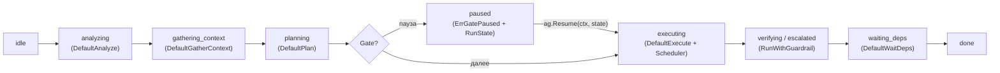

# Жизненный цикл FSM, Gates, снапшоты и планировщики DAG

---

## 1. Фазы конечного автомата (`AgentStatus`)

Каждый вызов `Run`, `RunDetailed`, `RunTask`, `Chat` или `StreamChat` создаёт изолированную сессию `runSession` и проводит её по стадиям `Pipeline[S]`:



### Стадии по умолчанию

1. **`StatusAnalyzing` (`DefaultAnalyze`, включается `WithEnableAnalyze(true)`):**
   Модель фазы `StatusAnalyzing` проводит первичный разбор задачи и записывает результат в `RunState.Analysis`. Если снапшот возобновляется через `RunFrom` / `Resume` и `Analysis` уже заполнен, вызов модели пропускается.
2. **`StatusGatheringContext` (`DefaultGatherContext`):**
   Собирает контекст из `[]DataSource`.
   - При включении **`WithSelectiveGather(true)`** (когда подключено больше одного источника) модель фазы `StatusGatheringContext` сначала выбирает по строгой JSON-схеме только те `DataSource.Name()`, которые нужны для текущей задачи, не загружая лишние таблицы.
   - Выполняет проверку `ValidateWindow(SystemPrefix, dynamicCtx, MaxContextTokens)`, гарантируя, что статический префикс и динамический контекст помещаются в окно модели.
3. **`StatusPlanning` (`DefaultPlan`, включается `WithEnablePlan(true)`):**
   Формирует промпт из `Task`, `ContextData` и `Analysis` через `text/template`, обращается к `PlanModel` (или `StageModels[StatusPlanning]`), очищает возможные markdown-ограждения ```` ```json ```` и сохраняет граф `[]PlanStep` в `RunState.Plan`.
   *У профильных субагентов с `WithSkipPlanning(true)` стадии анализа, сбора контекста и планирования пропускаются — они сразу переходят к `StatusExecuting`.*
4. **`StatusExecuting` (`DefaultExecute`):**
   Передаёт граф шагов `RunState.Plan` (либо одиночный шаг `step-1`) в `Scheduler`. Каждый узел проходит через защитный контур `RunWithGuardrail`, а его результат сохраняется в `RunState.StepResults[step.ID]`.
5. **`StatusWaitingDeps` (`DefaultWaitDeps`):**
   Финальная точка синхронизации, дожидающаяся завершения всех оставшихся фоновых субагентов (`activeFutures`).

### Кастомизация стадий и моделей

Любую стадию можно переопределить через `WithPipeline(Pipeline[S]{...})` или задать полностью собственный список стадий `Pipeline[S]{Custom: []Stage[S]{...}}`. Модели на каждую фазу назначаются независимо:

```go
ag := agentgo.New[MyState](
    agentgo.WithModel[MyState]("gemini-2.5-flash"),
    agentgo.WithStageModel[MyState](agentgo.StatusAnalyzing, "jev-latest"),
    agentgo.WithStageModel[MyState](agentgo.StatusGatheringContext, "jev-latest"),
    agentgo.WithStageModel[MyState](agentgo.StatusPlanning, "claude-sonnet-4-20250514"),
    agentgo.WithStageModel[MyState](agentgo.StatusExecuting, "jev-latest"),
    agentgo.WithStageModel[MyState](agentgo.StatusEscalated, "claude-sonnet-4-20250514"),
)
```

---

## 2. Контрольные точки (`Gates`), снапшоты и `Resume`

Для полуавтономного режима с подтверждением человека (например, утверждение плана перед рендером):

1. Укажите имена стадий в `WithGates("plan")` (доступные имена стандартных стадий: `"analyze"`, `"gather"`, `"plan"`, `"execute"`, `"wait_deps"`).
2. При необходимости добавьте хук `Hooks.OnGate(ctx, state, gate) (proceed bool, err error)` — если он возвращает `false` (или не задан), выполнение аккуратно ставится на паузу:
   - `RunDetailed(ctx)` возвращает `RunResult{Paused: true, Gate: "plan", State: snap}` и ошибку `ErrGatePaused` (проверяется через `errors.Is(err, agentgo.ErrGatePaused)`).
3. Снапшот можно атомарно сохранить на диск вместе с памятью агента:
   ```go
   _ = agentgo.SaveSnapshot("runs/run-42.json", res.State, ag.EnsureBank())
   ```
4. После подтверждения (или ручной правки `snap.RunState.Plan`) загрузите снапшот и продолжите выполнение ровно со следующей стадии:
   ```go
   loaded, _ := agentgo.LoadSnapshot("runs/run-42.json", ag.EnsureBank())
   finalRes, err := ag.Resume(ctx, loaded.RunState)
   ```
   Стадии из `CompletedStages` и уже готовые шаги из `StepResults` повторно не выполняются.

---

## 3. Планировщики DAG, веерный спавн и точечный `Await` (`SubFuture`)

### `SequentialScheduler` и `DAGParallelScheduler`

- **`SequentialScheduler`** (по умолчанию) — выполняет готовые шаги плана по одному в топологическом порядке, передавая выводы зависимостей (`DependsOn`) в промпт зависимого шага.
- **`DAGParallelScheduler{MaxConcurrency: N}`** — запускает независимые готовые шаги параллельно в горутинах с семафором `MaxConcurrency`, защитой от паник (`recover`) и гарантированным ожиданием завершения всех рабочих горутин при отмене контекста.
- При циклических или неразрешимых зависимостях оба планировщика немедленно возвращают ошибку.

### Веерный запуск 50+ субагентов и точечная синхронизация

Родительский агент может неблокирующе породить любое количество именованных фоновых субагентов через `ag.SpawnAsync(ctx, "tts_scene_3", child)` или изнутри инструмента через `ctx.SpawnNamed("tts_scene_3", child)`:

- Вызов мгновенно возвращает дескриптор `*Future` (`Await(ctx)`, `Done()`), не блокируя родителя.
- Если в графе шагов у узла `assemble_scene_3` указано `DependsOn: []string{"tts_scene_3"}`, планировщик **не ждёт остальные 49 субагентов**: он продолжает выполнять все независимые шаги, а узел `assemble_scene_3` разблокируется сразу в момент завершения конкретного `Future` `"tts_scene_3"`.

### Динамическое пополнение плана во время работы (`AppendPlanSteps`)

Любой шаг, хук или инструмент (включая встроенный `task_add` с параметром `add_to_plan: true`) может на ходу добавить новые узлы в текущий граф:

```go
agentgo.AppendPlanSteps(ctx, agentgo.PlanStep{
    ID:        "mix-scene-3",
    Task:      "Свести голос и музыку сцены 3",
    DependsOn: []string{"tts_scene_3"},
})
```

Оба планировщика автоматически подхватывают добавленные шаги в рамках текущего `Run`.

